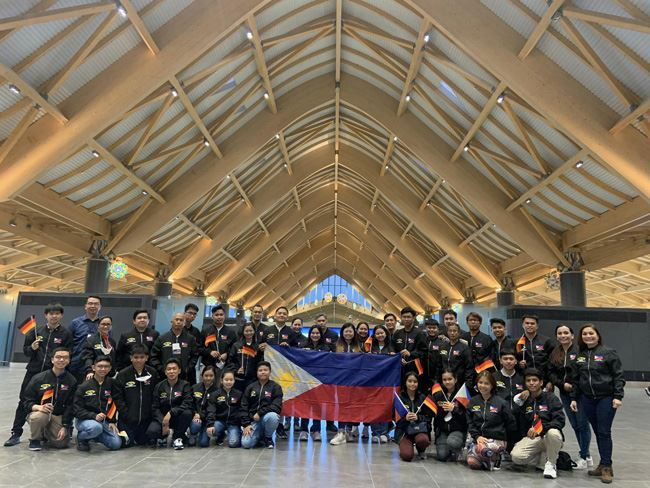
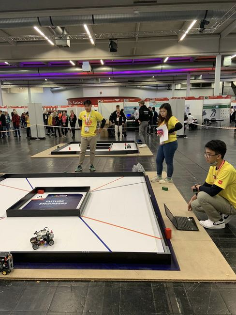

<p align="center">
  
</p>

<p align="center">
  <b>I build software end to end:</b> Rust desktop apps, polyglot microservices,<br/>
  offline-first mobile apps, and the infrastructure that keeps them running.
</p>

<p align="center"></p>

## `$ whoami`

```yaml
unit:            JLM-01
designation:     Jan Lancelot P. Mailig
class:           Software Engineer
core_languages:  [Rust, TypeScript, Java, Go, Python]
current_mission: Shipping the RouteVN Web Extractor
side_quests:     [Japanese-immersion tooling, Rust desktop apps, video editing]
origin_story:    WRO Future Engineers · Philippine national team, WRO 2022 Germany
operating_mode:  spec-first · test-backed · documented
```

<p align="center"></p>

## Current mission: [RouteVN Web Extractor](https://routevn.com/en/web-extractor/)

A browser extension for reading web-based visual novels. It reads dialogue straight from Ren'Py Web and TyranoScript games instead of using OCR, and shows it in an overlay with a pop-up Japanese/English dictionary, pitch accent, furigana and one-key Anki export.

<p align="center"></p>

## Robotics: where the robots come from

Before the robots on this page were SVGs, they were real. I competed in the World Robot Olympiad's **Future Engineers** category, where teams design, build and program a self-driving robot car that completes a randomized course on its own.

<p align="center">
  
</p>

<table>
<tr>
<td align="center" valign="top">
<br/>
<sub>The Philippine Robotics National Team, WRO 2022</sub>
</td>
<td align="center" valign="top">
<br/>
<sub>Live at the Future Engineers field, Dortmund</sub>
</td>
</tr>
</table>

<p align="center"><sub>Photos: <a href="https://www.felta.ph/2022/philippine-robotics-national-team-dyci-primes-won-gold-score-ranking-and-bronze-award-at-world-robot-olympiad-germany-2022/">FELTA Multi-Media Inc.</a>, national organizer of the Philippine Robotics National Team</sub></p>

<p align="center"></p>

## Installed modules

| Subsystem | Modules |
| :-- | :-- |
| **Languages** |  |
| **Frontend & apps** | <br/><sub>+ React Native · Expo · egui · Rettangoli</sub> |
| **Backend & APIs** | <br/><sub>+ gRPC · Temporal · FastAPI · Convex · Better Auth</sub> |
| **Data & messaging** | <br/><sub>+ Drizzle · Qdrant</sub> |
| **Infra & observability** | <br/><sub>+ Helm · Argo CD · Istio · KEDA · OpenTelemetry · Packer</sub> |
| **Testing** | <br/><sub>+ Playwright · k6</sub> |

<p align="center"></p>

## Featured builds

<table>
<tr>
<td width="50%" valign="top">

### [mosaic-maker](https://github.com/JanLancelot/mosaic-maker)
A desktop app that rebuilds a picture out of many smaller pictures, then lets you inspect which picture fills each tile. Source images are identified by a BLAKE3 hash of their contents, so a duplicated file only counts once.

`Rust` `egui` `Rayon` `BLAKE3`

</td>
<td width="50%" valign="top">

### [nexus-supply-chain](https://github.com/JanLancelot/nexus-supply-chain)
A supply-chain platform with purchase-order approvals, warehouse stock control, and low-stock events that draft replenishment orders. It ships with Grafana dashboards, alerting and a measured reliability case study.

`Spring Boot` `React` `PostgreSQL` `Redis` `Kafka` `Prometheus` `Azure`

</td>
</tr>
<tr>
<td width="50%" valign="top">

### [goat-ecommerce](https://github.com/JanLancelot/goat-ecommerce)
A polyglot microservices marketplace. Go order and payment services run Temporal workflows over gRPC, NestJS GraphQL subgraphs sit behind an Apollo Federation gateway, and a FastAPI + Qdrant service makes recommendations. Deploys through Helm, Argo CD, Istio and KEDA.

`Go` `NestJS` `GraphQL` `Temporal` `Kubernetes` `k6`

</td>
<td width="50%" valign="top">

### [licensify](https://github.com/JanLancelot/licensify) · [live ↗](https://react-native-repo.vercel.app)
An offline-first reviewer app for the Philippine Architectural Licensure Examination. It has mock board exams, flashcards, gamification and a web admin dashboard, and syncs a local SQLite store with Convex.

`React Native` `Expo` `Convex` `SQLite` `Drizzle`

</td>
</tr>
<tr>
<td width="50%" valign="top">

### [ZOC](https://github.com/JanLancelot/zoc-ticktick-clone) · [live ↗](https://zoc-productivity.vercel.app)
A TickTick-inspired task, habit and focus tracker. It has list, kanban and calendar views, iCal RRULE recurrence, habit streaks and a Pomodoro timer.

`Next.js 16` `React 19` `Prisma` `PostgreSQL` `Better Auth`

</td>
<td width="50%" valign="top">

### [japan-os](https://github.com/JanLancelot/japan-os)
A Japanese-immersion workstation in the browser. An EPUB reader, a manga reader with in-browser OCR, a texthooker and a video player all share one pop-up dictionary.

`Next.js` `TypeScript` `Tesseract.js`

</td>
</tr>
</table>

<details>
<summary><b>More from the archive</b></summary>
<br/>

| Project | What it does | Stack |
| :-- | :-- | :-- |
| [GasGuessr](https://github.com/JanLancelot/GasGuessr) | Fuel-cost simulator with a trip calculator, budget estimator and sensitivity charts | React Native · Expo |
| [Mind Wallet](https://github.com/JanLancelot/mind-wallet-pro-elec) · [live ↗](https://mind-wallet-pro-elec.vercel.app) | Budget tracker that graphs spending against mood | React · Firebase |
| [Volunteer Match](https://github.com/JanLancelot/icp-new-dapp) · [live ↗](https://icp-new-dapp.vercel.app) | Matches volunteers with organizations and their events | React · Express · SQLite |

</details>

<p align="center"></p>

## Broadcast module: [Liquid on YouTube](https://www.youtube.com/@Liquid-0911/featured)

Off the clock I edit videos, mostly about anything otaku. My favorite builds are the ones where code and editing meet, like turning thousands of Minecraft bees into a display.

<table>
<tr>
<td width="50%" align="center" valign="top">
<a href="https://www.youtube.com/watch?v=M6KbG3wA2bE"></a>

### [Playing DOOM using 16,000 Minecraft Bees](https://www.youtube.com/watch?v=M6KbG3wA2bE)
DOOM runs inside Minecraft, and 16,000 bees act as the pixels. A Java ASM agent hooks the game client and a native JNI bridge runs the DOOM engine.

`Java` `ASM` `JNI` `C`

</td>
<td width="50%" align="center" valign="top">
<a href="https://www.youtube.com/watch?v=5VYAtK2ZqHE"></a>

### [Bad Apple!! But it's Minecraft bees.](https://www.youtube.com/watch?v=5VYAtK2ZqHE)
My take on the internet's "Bad Apple!! on everything" challenge: the whole shadow-art music video, played back with Minecraft bees as the pixels.

`Minecraft` `Video editing`

</td>
</tr>
</table>

<p align="center"><a href="https://www.youtube.com/@Liquid-0911"></a></p>

<p align="center"></p>

<p align="center">
  
</p>
